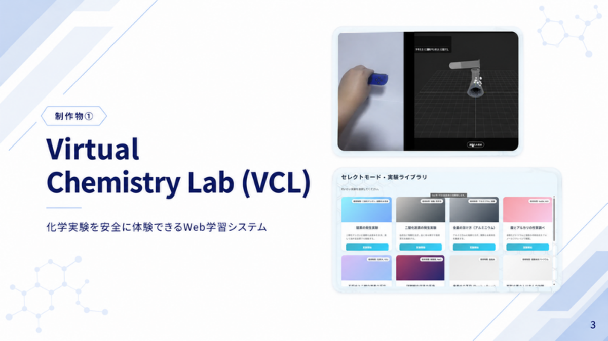
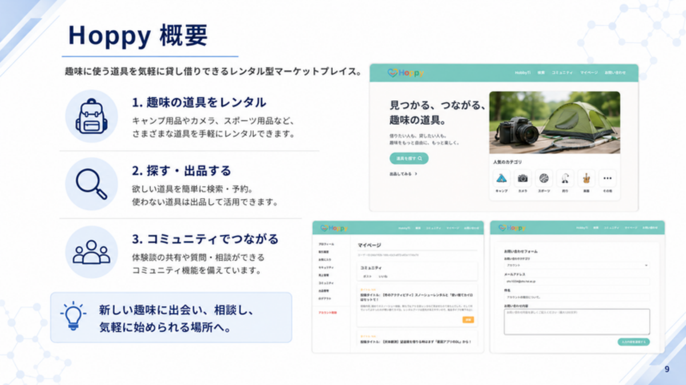

# Akihiro

大阪の専門学校で、Webアプリケーションの設計と実装を学んでいます。

チーム開発では、使う人の迷いや不安を見つけ、画面体験・機能設計・進行管理へ落とし込むことを大切にしています。技術を並べるだけでなく、何を解決するために使ったのかを説明できる状態を目指しています。

  
  

## Works

| Project | Overview | My role | Tech |
| --- | --- | --- | --- |
| [Portfolio](https://github.com/indo40722/portfolio) | ポートフォリオサイト | React + TypeScriptで画面構成、作品情報、GitHub Pages公開を整理 | React, TypeScript, Vite |
| [VCL / Virtual Chemistry Lab](https://github.com/indo40722/vcl-case-study) | Joy-Con操作と3D表現で化学実験を安全に体験できる学習システム | 4人チームのリーダー。仕様整理、入力方式の検証、技術選定、役割分担、画面体験の設計を担当 | Node.js, Socket.IO, Three.js, Joy-Con |
| Hoppy | 趣味道具を貸し借りできるWebサービス。商品レンタルに加え、コミュニティとサポートを一つの体験として設計 | 投稿、画像投稿、いいね、コメント、Q&A、フォロー、お問い合わせ、FAQ、利用ガイドを実装 | Python, Flask, HTML, CSS, JavaScript, MySQL |
| [Joy-Con Web Input Demo](https://github.com/indo40722/joycon-web-input-demo) | Joy-ConをWebアプリの入力デバイスとして使うための検証メモ | VCLで使う入力方式の候補として、操作感と実装可能性を整理 | Joy-Con, Web Input, JavaScript |
| [学生データ分析AWARD 2025](https://techplay.jp/column/2101) | 初対面の3人チームで社会課題を分析し、短時間で提案発表までまとめたコンテスト | 資料とオープンデータの読み込み、論点整理、解決策の方向性、発表ストーリーの組み立てに参加 | Data Analysis, Open Data, Presentation |

## VCL

実際の薬品を使わずに、注ぐ、混ぜる、反応を見るという流れをWeb上で体験できる学習システムです。

入力方式は最初からJoy-Conに決めていたわけではありません。画像認識、QRコード、RGB検出、マイコンとジャイロセンサーなどを検討し、操作体験と実装の現実性を見ながらJoy-Conを採用しました。

学内コンテストでは金賞を受賞しました。

## Hoppy

カメラ、アウトドア用品、楽器などの趣味道具を貸し借りできるWebサービスです。レンタル機能だけでなく、投稿、Q&A、フォロー、サポートまで含めて、趣味を始める前の不安を減らす体験を目指しました。

担当したのは、コミュニティ機能とサポート機能です。Python / Flask、MySQL / MariaDB、HTML / CSS / JavaScriptを使い、投稿、画像投稿、いいね、コメント、Q&A、フォロー、お問い合わせ、FAQ、利用ガイドを実装しました。

4人チームで7か月制作し、チーム合計開発時間は1044時間です。Webシステム学内コンペで銀賞を受賞しました。

## Awards

| Date | Contest | Result | Project |
| --- | --- | --- | --- |
| 2026.03.16 | Webシステム学内コンペ | 銀賞 | Hoppy |
| 2026.03.10 | HAL EVENT WEEK | 金賞 | VCL / Virtual Chemistry Lab |
| 2026.03.07-08 | [学生データ分析AWARD 2025](https://techplay.jp/column/2101) | 準優勝 | 社会課題分析 |
| 2025.03.10 | HAL EVENT WEEK | 技術力賞 | Halter |
| 2024.10.07 | アーティストサイトデザイン学内コンペ | 独創力賞 | アーティストサイトデザイン |

## Focus

- 目的から技術を選ぶ
- 実装前に複数案を検証する
- ただ動くだけでなく、ユーザーに伝わる体験にする
- チームで判断理由を共有できるよう、仕様や設計を言語化する
